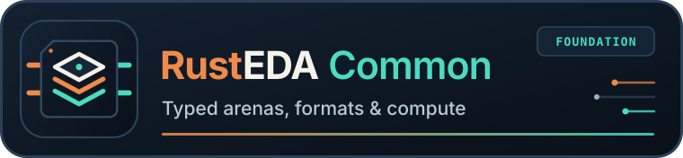
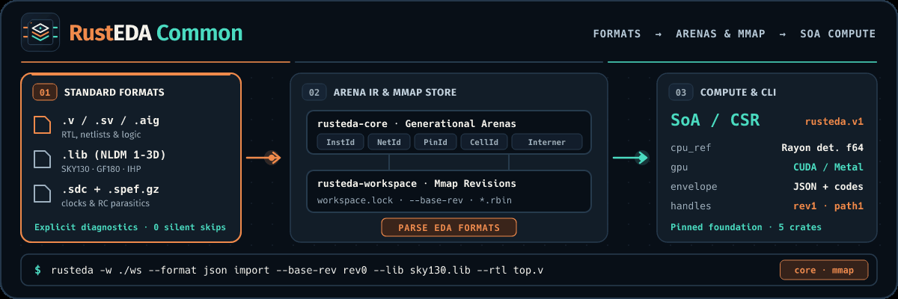

<p align="center">
  
</p>

<p align="center">
  <strong>The shared Rust foundation powering RustEDA: generational arena IRs, EDA format parsers, daemonless mmap workspaces, and SoA/CSR compute kernels.</strong><br>
  <a href="https://lab-emi.github.io/RustEDA/modules/rusteda-common/">Documentation</a> ·
  <a href="https://github.com/lab-emi/RustEDA">RustEDA Suite</a> ·
  <a href="https://lab-emi.github.io/RustEDA/shared-foundation/">Shared Workflow</a> ·
  <a href="docs/development-status.md">Development Status</a> ·
  <a href="LICENSE">Apache-2.0</a>
</p>

<picture>
  <source media="(prefers-reduced-motion: reduce)" srcset="docs/assets/rusteda-common-banner.svg">
  
</picture>

## Why RustEDA Common

`RustEDA-Common` is the single pinned source of truth consumed by `RustSys`, `RustSTA`, and the integrated `RustEDA` applications (`rusteda flow` and `RustEDA Studio`). It enforces the suite's clean-room architecture at the crate boundary: zero `Rc<RefCell<T>>` graphs, per-database string interning, zero background daemons, and deterministic `f64` compute primitives.

| Crate | Responsibility | Key Contracts |
| --- | --- | --- |
| **`rusteda-core`** | Generational arena IRs (`InstId`, `NetId`, `PinId`, `CellId`) & per-DB `SymbolInterner` | Zero global mutable state; strict separation of mutable IR from compute views |
| **`rusteda-formats`** | Strict Verilog, SystemVerilog, Liberty (`.lib` NLDM 1D–3D), SDC, SPEF (`.spef.gz`), BLIF, AIGER | Tri-PDK (`sky130`, `gf180mcu`, `ihp-sg13g2`) + SRAM buses; zero silent constraint ignores |
| **`rusteda-workspace`** | Daemonless disk workspace (`workspace.lock`, `memmap2` `.rbin` side-tables) | `--base-rev` optimistic concurrency (`REVISION_CONFLICT`); shared zero-copy reads |
| **`rusteda-compute`** | Contiguous SoA/CSR batch buffers (`cpu_ref` Rayon first, optional native CUDA / Metal) | Deterministic `f64` RC charge fitting & timing propagation kernels |
| **`rusteda-cli-common`** | Unified `rusteda.v1` JSON envelope, shell-safe handles (`rev1`, `path1`, `sel1`), coded errors | Shared CLI plumbing with honest scope telemetry (`corner`, `wire_model`, `unconstrained`) |

## Impact Across the Suite

`RustEDA-Common` has no standalone benchmark ratio of its own — it compiles directly into `RustSys`, `RustSTA`, and the `rusteda` workspace CLI, where shared SPEF deduplication, compact arena layouts, and zero-copy `.rbin` side-tables help power:

- **33.8×–47.4×** synthesis speedup (`RustSys` vs `Yosys + ABC`, `6.6×` less RAM)
- **2.0×** multi-corner timing speedup (`RustSTA` vs `OpenSTA`, `12.6%–29.5%` less RAM, `≤ 0.270 ps` parity)
- **3.55×–8.39×** end-to-end RTL-to-GDS speedups across `IHP SG13G2`, `SKY130A`, and `GF180MCU D`

See [RustEDA Benchmarks](https://lab-emi.github.io/RustEDA/benchmarks/) for complete receipts and scope.

## Quick Start

```sh
# Test all five foundation crates (or via superproject: ./dev test RustEDA-Common)
cargo test --workspace

# Verify exact pin alignment across RustSys, RustSTA, and RustEDA apps
./dev shared
```

## Specifications & Contracts

- [Core Models & Netlist IR](docs/specs/core/README.md) · [Workspace & Binary Tables](docs/specs/workspace/README.md) · [Compute Kernels](docs/specs/compute/README.md)
- [Verilog](docs/specs/verilog/verilog.md) · [Liberty](docs/specs/liberty/liberty.md) · [SDC](docs/specs/sdc/sdc.md) · [SPEF & Connectivity CLI](docs/specs/rusteda-cli/README.md)

## Scope & Current Limits

- **Pin-exact consumption**: Downstream repositories pin one exact Git commit revision in `Cargo.toml` / `Cargo.lock` (verified by `./dev shared` and `verification/shared.sha256`); never depend on floating branches.
- **CPU baseline vs GPU experiments**: Deterministic pure-Rust `cpu_ref` is the production baseline; experimental CUDA crossing-query prototypes live on separate branches and are not qualified for RTL-to-GDS signoff.
- **No Python or GUI dependencies**: Foundation crates remain 100% pure Rust.

## License

Apache-2.0 — see [LICENSE](LICENSE).
