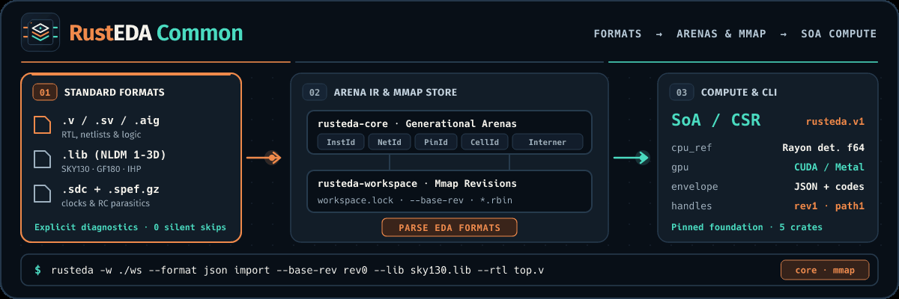

# RustEDA Common

Shared generational arena IRs, strict EDA format parsers, daemonless memory-mapped workspaces, contiguous SoA/CSR compute kernels, and CLI contracts powering the RustEDA suite.

[All RustEDA modules](https://lab-emi.github.io/RustEDA/) · [Shared workflow](https://lab-emi.github.io/RustEDA/shared-foundation/) · [Development status](development-status.md)

<picture>
  <source media="(prefers-reduced-motion: reduce)" srcset="assets/rusteda-common-banner.svg">
  
</picture>

## Crate Map

| Crate | Role | Specification |
| --- | --- | --- |
| `rusteda-core` | Generational arenas (`InstId`, `NetId`, `PinId`, `CellId`) & per-DB interning | [Core specs](specs/core/README.md) |
| `rusteda-formats` | Strict Verilog, Liberty (NLDM 1D–3D), SDC, SPEF, BLIF, AIGER parsers | [Verilog](specs/verilog/verilog.md) · [Liberty](specs/liberty/liberty.md) · [SDC](specs/sdc/sdc.md) |
| `rusteda-workspace` | Daemonless `workspace.lock`, `--base-rev` guard & `memmap2` `.rbin` tables | [Workspace specs](specs/workspace/README.md) |
| `rusteda-compute` | Contiguous SoA/CSR compute kernels (`cpu_ref` Rayon + optional CUDA/Metal) | [Compute specs](specs/compute/README.md) |
| `rusteda-cli-common` | `rusteda.v1` JSON envelope, shell-safe handles & coded diagnostics | [CLI specs](specs/rusteda-cli/README.md) |

## Verification Boundaries

- Downstream repositories (`RustSys`, `RustSTA`, `apps/`) pin one exact `RustEDA-Common` commit verified by `./dev shared`.
- Foundation CPU tests verify format, workspace, and kernel invariants; physical signoff and GPU integration are qualified separately per engine. See [Development status](development-status.md).
